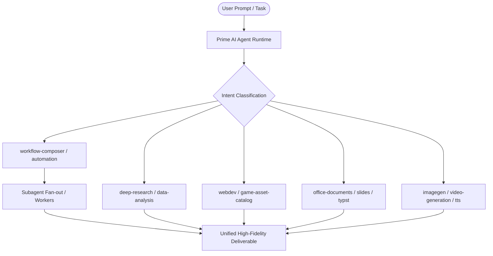

<div align="center">

# ⚡ Prime AI Agent Skills Suite

### *The Complete Production-Ready Framework of 39 Modular Skills for Autonomous AI Agents*

[](https://opensource.org/licenses/MIT)
[](./skills)
[](./CONTRIBUTING.md)
[](#)
[](https://github.com/mohdkhatab)

<p align="center">
  <b>Multi-Agent Orchestration</b> • 
  <b>Deep Web Research</b> • 
  <b>Full-Stack Web & Game Development</b> • 
  <b>Document & Presentation Synthesis</b> • 
  <b>Enterprise Automation</b>
</p>

---

</div>

## 🌟 Overview

**Prime AI Agent Skills Suite** is a battle-tested, highly modular library of **39 agentic skills** designed to turn any Large Language Model or agentic coding environment into an elite, fully autonomous AI agent.

Whether you are building with **Antigravity**, **Claude Code**, **Cursor**, **OpenAI Swarm**, **LangChain**, **AutoGen**, or your own custom agent runtime, these skills provide the explicit operational runbooks, deterministic subagent orchestration scripts, prompt contracts, and tooling schemas needed to execute complex multi-step tasks without human intervention.

---

## 📑 Table of Contents

- [Core Highlights](#-core-highlights)
- [Architecture Overview](#-architecture-overview)
- [Flagship Skills Showcase](#-flagship-skills-showcase)
- [Complete Skills Directory (All 39 Skills)](#-complete-skills-directory)
  - [1. Multi-Agent Orchestration & Core Workflows](#1-multi-agent-orchestration--core-workflows)
  - [2. Full-Stack Web, Mobile & Game Development](#2-full-stack-web-mobile--game-development)
  - [3. Deep Research & Data Intelligence](#3-deep-research--data-intelligence)
  - [4. Office & Document Synthesis Engine](#4-office--document-synthesis-engine)
  - [5. Creative AI & Multi-Modal Generation](#5-creative-ai--multi-modal-generation)
  - [6. Cloud, Networking & System Services](#6-cloud-networking--system-services)
  - [7. Platform API & Configuration](#7-platform-api--configuration)
- [Quickstart & Installation](#-quickstart--installation)
- [Configuring Placeholders](#-configuring-placeholders)
- [Repository Structure](#-repository-structure)
- [Contributing](#-contributing)
- [License & Author](#-license--author)

---

## 🚀 Core Highlights

- 🧠 **Deterministic Multi-Agent Swarms:** Fan out 5 to 50+ concurrent agents using `workflow-composer` to research, analyze, and aggregate data into unified deliverables.
- 🔍 **Academic-Grade Deep Research:** Unbiased multi-source web traversal with automated source cross-checking, citations, and zero-hallucination report generation.
- 💻 **Zero-to-One Full-Stack Web & Game Dev:** Complete scaffolds for React/Next.js websites, Expo/React Native mobile applications, and Three.js/Phaser/Godot games.
- 📊 **Enterprise Office Automation:** Programmatic generation and editing of `.docx`, `.xlsx`, `.pdf` (via Typst), and `.pptx` (via XML/HTML-to-Slides engines).
- 🔌 **Plug & Play Extensibility:** Zero proprietary lock-in. All endpoint configurations and services use clean placeholders (`<YOUR_API_URL>`, `<YOUR_LINK>`, `<YOUR_DOMAIN>`) ready for your custom deployment.

---

## 🏛 Architecture Overview

Each skill in this repository is self-contained in its own directory and adheres to the universal Agent Skill Contract:

```
skills/<skill-name>/
├── SKILL.md                 # Primary instruction manifest with YAML metadata
├── scripts/                 # (Optional) Deterministic execution utilities (Node.js/Python)
├── references/              # (Optional) Technical routing guides, schemas, and best practices
└── templates/               # (Optional) Starter templates and boilerplates
```



---

## 🏆 Flagship Skills Showcase

### 1. `workflow-composer` — Multi-Agent Parallel Swarms
> *MANDATORY when handling 5 or more independent, comparable items.*
- **Capabilities:** Implements deterministic subagent fan-out, map/reduce workflows, dynamic loops, and result collation.
- **Why it matters:** Instead of a single LLM hallucinating over 20 items in a single context window, `workflow-composer` launches dedicated subagents per item and synthesizes the outputs into structured tables or reports.

### 2. `deep-research` — Fact-Grounded Deep Web Research
> *For exhaustive, audit-ready research reports.*
- **Capabilities:** Progressive multi-hop search queries, direct URL navigation (bypassing incomplete search snippets), contradicting evidence reconciliation, and inline citation binding.
- **Deliverable:** Natural, clear, jargon-free reports designed for high readability.

### 3. `webdev` — Autonomous Web, Mobile & Game Studio
> *Production apps built from zero to deployment.*
- **Capabilities:** Web scaffolding, Expo mobile apps, 2D/3D game development (HTML5 Canvas, Phaser, Three.js, Godot), SEO auditing, and preview runtime management.
- **Assets Integration:** Bundled with `game-asset-catalog` for instant 2D sprites, 3D models, fonts, and sound effects.

### 4. `slides` & `office-documents` — Enterprise Document Engine
> *Pixel-perfect slides and corporate documents.*
- **Capabilities:** Native Word (`.docx`), Excel spreadsheets with formulas (`.xlsx`), Typst-compiled academic PDFs (`typst-pdf-maker`), and PowerPoint presentations built via direct PPTX-XML manipulation.

### 5. `builtin-llm-models` — Dynamic Multi-LLM Routing
> *Live model catalog inspection and intelligent fallbacks.*
- **Capabilities:** OpenAI-compatible proxy routing, dynamic pricing and token context calculation, reasoning effort tuning, and structured JSON output enforcement.

---

## 📚 Complete Skills Directory

Here is the complete catalog of all **39 skills** included in this suite:

### 1. Multi-Agent Orchestration & Core Workflows
| Skill | Directory | Description |
| :--- | :--- | :--- |
| **Workflow Composer** | [`workflow-composer`](./skills/workflow-composer) | Deterministic JavaScript subagent orchestration for map/reduce, loops, and parallel fan-outs (5+ items). |
| **Automation & Scheduling** | [`automation-and-scheduling`](./skills/automation-and-scheduling) | Intent-based routing for recurring tasks, condition monitors, background jobs, and ScheduleTask. |
| **Triggers** | [`triggers`](./skills/triggers) | Event-driven automation using provider webhooks, timers, and scheduled monitoring scripts. |
| **Tasks Manager** | [`prime-ai-agent-tasks`](./skills/prime-ai-agent-tasks) | Programmatic subtask creation, task inspection, message logs, and execution checkpointing. |
| **Device Handoff** | [`handoff`](./skills/handoff) | Secure peer-to-peer file transfer between cloud sandboxes, local machines, and remote runners. |

### 2. Full-Stack Web, Mobile & Game Development
| Skill | Directory | Description |
| :--- | :--- | :--- |
| **WebDev Core** | [`webdev`](./skills/webdev) | End-to-end web apps, React/Expo mobile applications, and 2D/3D browser games. |
| **WebDev SEO** | [`webdev-seo`](./skills/webdev-seo) | Search discoverability, crawler-visible HTML, meta tags, OpenGraph previews, and robots.txt. |
| **Work Locally** | [`webdev-worklocally`](./skills/webdev-worklocally) | Local First development guide on local workstations vs. isolated cloud compute sandboxes. |
| **Game Asset Catalog** | [`game-asset-catalog`](./skills/game-asset-catalog) | Integrated search and retrieval for 2D sprites, 3D models, UI components, fonts, and audio SFX. |

### 3. Deep Research & Data Intelligence
| Skill | Directory | Description |
| :--- | :--- | :--- |
| **Deep Research** | [`deep-research`](./skills/deep-research) | Exhaustive multi-source research engine with evidence gathering and citation rules. |
| **Data Analysis** | [`data-analysis`](./skills/data-analysis) | Python and Pandas data manipulation, statistical processing, and automated charting. |
| **Data API** | [`data-api`](./skills/data-api) | External data lookups (Twitter/X posts & profiles, LinkedIn entities, and 3D asset generation). |
| **Finance Pro Playbooks** | [`finance-pro-playbooks`](./skills/finance-pro-playbooks) | Professional financial modeling, discounted cash flow (DCF) valuation, and equity research. |

### 4. Office & Document Synthesis Engine
| Skill | Directory | Description |
| :--- | :--- | :--- |
| **Slides Engine** | [`slides`](./skills/slides) | Automated presentation creation via HTML syntax and direct PPTX-XML manipulation. |
| **Office Documents** | [`office-documents`](./skills/office-documents) | Generate and modify Word (`.docx`), Excel (`.xlsx`), and PDF documents. |
| **Office Cloud Editor** | [`office`](./skills/office) | Web-based collaborative document manipulation, annotations, and formula editing. |
| **Typst PDF Maker** | [`typst-pdf-maker`](./skills/typst-pdf-maker) | Academic-grade document typesetting (resumes, papers, reports) compiled directly via Typst. |

### 5. Creative AI & Multi-Modal Generation
| Skill | Directory | Description |
| :--- | :--- | :--- |
| **Image Generation** | [`imagegen`](./skills/imagegen) | High-fidelity image generation, aspect ratio routing, upscaling, and visual asset editing. |
| **Image Processing** | [`image-processing`](./skills/image-processing) | Programmatic image manipulation, visual inspections, filters, and image transformations. |
| **Vision OCR** | [`read-special-images`](./skills/read-special-images) | OCR for long webpage screenshots, panoramic photos, dense diagrams, and high-res documents. |
| **Video Generation** | [`video-generation`](./skills/video-generation) | Automated video clipping, highlight extractions, and motion graphics authoring. |
| **Music Prompter** | [`music-prompter`](./skills/music-prompter) | Detailed musical prompt crafting (genres, tempos, instrumentation, vocal styling). |
| **TTS Prompter** | [`tts-prompter`](./skills/tts-prompter) | Speech synthesis prompt engineering (pacing, emotional inflections, phoneme precision). |

### 6. Cloud, Networking & System Services
| Skill | Directory | Description |
| :--- | :--- | :--- |
| **Persistent Computing** | [`persistent-computing`](./skills/persistent-computing) | Deploying 24/7 persistent background services, daemons, and cloud worker computers. |
| **Tailscale Network** | [`tailscale-network`](./skills/tailscale-network) | Connecting sandbox and cloud instances into private user Tailscale VPN mesh networks. |
| **Google Workspace** | [`google-workspace-integration`](./skills/google-workspace-integration) | Direct integration with Google Drive, Docs, Sheets, and Slides. |
| **GWS Best Practices** | [`gws-best-practices`](./skills/gws-best-practices) | Production patterns for high-throughput Google Workspace CLI (`gws`) operations. |
| **GitHub Integration** | [`github-integration`](./skills/github-integration) | Repository management, commits, pull requests, and automated branch staging. |
| **Git Attribution** | [`git-attribution`](./skills/git-attribution) | Co-authorship tagging and Git commit attribution standards for agentic edits. |
| **Touchpoint Contacts** | [`touchpoint-contacts`](./skills/touchpoint-contacts) | Authorized SMS, email delivery, and user verification code dispatching. |
| **Payment & Checkout** | [`payment`](./skills/payment) | Handling Stripe Link wallets, checkout sessions, and payment takeover workflows. |
| **Trip Booking** | [`trip`](./skills/trip) | Flight and hotel search integration with structured deal cards. |
| **Data Backup** | [`data-backup-restoration`](./skills/data-backup-restoration) | Full task, database, website, and assets snapshot backup and recovery system. |

### 7. Platform API & Configuration
| Skill | Directory | Description |
| :--- | :--- | :--- |
| **Prime AI Agent API** | [`prime-ai-agent-api`](./skills/prime-ai-agent-api) | Complete OpenAPI v2 specification, task endpoints, OAuth2 flows, and webhooks. |
| **Config Addon** | [`prime-ai-agent-config`](./skills/prime-ai-agent-config) | Agent profiles, custom MCP connectors, workspace guidelines, and shared files. |
| **Session Config** | [`session-self-config`](./skills/session-self-config) | Dynamic runtime discovery and self-configuration of external connectors and browsers. |
| **Built-in LLM Catalog** | [`builtin-llm-models`](./skills/builtin-llm-models) | OpenAI-compatible proxy client, model price lookup, and reasoning effort controls. |
| **Skill Creator** | [`skill-creator`](./skills/skill-creator) | Automated authoring engine for scaffolding and publishing new agent skills. |
| **Support Policy** | [`support-policy`](./skills/support-policy) | Technical support boundaries, subscription inquiries, and feedback collection. |

---

## 🛠 Quickstart & Installation

### Step 1: Clone the Repository
```bash
git clone https://github.com/mohdkhatab/prime-ai-agent-skills.git
cd prime-ai-agent-skills
```

### Step 2: Load Skills into Your AI Agent

Depending on the environment you use:

#### For Antigravity / Agentic Coding Assistants:
Point your agent workspace to the `skills/` directory or copy specific skills into your configuration folder:
```bash
cp -r skills/deep-research ~/.gemini/antigravity/builtin/skills/
```

#### For Claude Code / Cursor / Codex:
Add the path of the desired `SKILL.md` file to your agent's system prompt or rules file (e.g. `.cursorrules` or `CLAUDE.md`):
```markdown
# Agent Capabilities
Refer to the operational workflows specified in:
- skills/workflow-composer/SKILL.md
- skills/deep-research/SKILL.md
- skills/webdev/SKILL.md
```

---

## ⚙️ Configuring Placeholders

All skills in this suite are 100% agnostic and decoupled from proprietary services. When deploying into your own environment, search and replace the standard placeholders:

| Placeholder | Purpose | Example Replacement |
| :--- | :--- | :--- |
| `<YOUR_API_URL>` | Your backend API endpoint | `api.yourcompany.com` |
| `<YOUR_DOCS_URL>` | Your documentation portal | `docs.yourcompany.com` |
| `<YOUR_DOMAIN>` | Your primary web domain | `yourcompany.com` |
| `<YOUR_LINK>` | Specific external reference link | `https://yourcompany.com/portal` |
| `<YOUR_EMAIL>` | Support or notification email | `support@yourcompany.com` |
| `<YOUR_CDN_URL>` | Media CDN host | `cdn.yourcompany.com` |

---

## 📂 Repository Structure

```text
prime-ai-agent-skills/
├── skills/                     # 39 Self-contained Agent Skills
│   ├── .skill_versions.json    # Skill package version registry
│   ├── workflow-composer/      # Subagent swarm coordinator
│   ├── deep-research/          # Multi-source web research engine
│   ├── webdev/                 # Web, mobile & game development engine
│   ├── slides/                 # PPTX / HTML slide presentation engine
│   ├── office-documents/       # Word, Excel & PDF generator
│   └── ... (34 other skills)
├── CONTRIBUTING.md             # Contribution guidelines
├── LICENSE                     # MIT License
└── README.md                   # Complete documentation
```

---

## 🤝 Contributing

Contributions, bug reports, and new skills are welcome! Please check out [CONTRIBUTING.md](./CONTRIBUTING.md) to get started.

1. Fork the Project
2. Create your Feature Branch (`git checkout -b feature/AmazingSkill`)
3. Commit your Changes (`git commit -m 'feat: add AmazingSkill'`)
4. Push to the Branch (`git push origin feature/AmazingSkill`)
5. Open a Pull Request

---

## 📄 License & Maintainer

Distributed under the **MIT License**. See [`LICENSE`](./LICENSE) for more information.

Developed and maintained with passion by **[Mohd khatab](https://github.com/mohdkhatab)**.
- 🌐 Portfolio / Blog: [codewithkhatab.in](https://codewithkhatab.in)
- 💼 GitHub: [@mohdkhatab](https://github.com/mohdkhatab)

<div align="center">
  <sub>⭐ If you find this skills suite valuable, please star this repository on GitHub! ⭐</sub>
</div>
